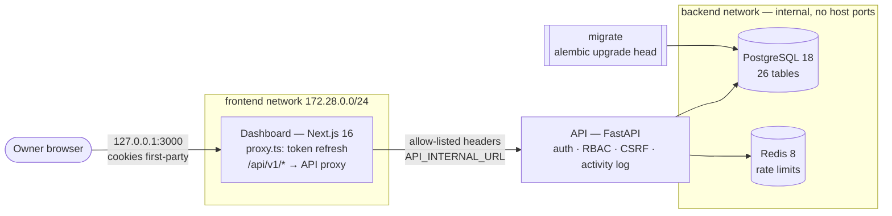

# Architecture Overview

Target architecture is defined in [`docs/spec/02_SYSTEM_ARCHITECTURE.md`](../spec/02_SYSTEM_ARCHITECTURE.md).
This page shows what exists **now** (through Phase 01) and what later phases add.
Schema: [`schema.md`](schema.md). Auth design: [`../security/authentication.md`](../security/authentication.md).

## Implemented

| Component | Responsibility now |
|---|---|
| Dashboard | Login, MFA verify/enrol, forced password change, status, account security, users admin, activity log. Proxies `/api/v1/*` to the API on its own origin; refreshes expired access tokens in `proxy.ts`. |
| API | Validated settings, structured redacted logs, health, `/api/v1/auth`, `/api/v1/users`, `/api/v1/activity`, RBAC, CSRF, rate limits, append-only activity log, owner bootstrap CLI. |
| migrate | One-shot container that applies migrations before the API starts. |
| PostgreSQL | Full schema (migration 0001); business tables staged for later phases. |
| Redis | Login/MFA rate-limit counters (password auth, AOF). Queues arrive in Phase 03. |

### Networks
- `backend` is `internal: true`: PostgreSQL and Redis have no route to the internet and no published ports.
- `frontend` carries API ↔ dashboard traffic and the two loopback-only published ports.

## Request flow

1. A request enters the API through `RequestContextMiddleware`, which accepts a safe caller
   `X-Request-ID` (8–128 chars of `[A-Za-z0-9._-]`) or generates one, binds it to the log
   context, and echoes it in the response.
2. Every log line is JSON with UTC timestamp, level, `request_id` and a redaction pass that
   masks sensitive keys (password, token, key, email, phone, address…) and value patterns
   (URL credentials, bearer tokens, provider key shapes, email addresses).
3. Access logs record method, path (no query string), status and duration.

## Added by later phases

Source adapters (02) → discovery workers and Celery queues (03) →
isolated audit browser (04) → AI briefs (05) → design/render sandbox (06) → validation (07) →
proposals and preview gateway (08) → compliant email (09) → full console (10) → Caddy, TLS,
backups, monitoring on the VPS (11).
