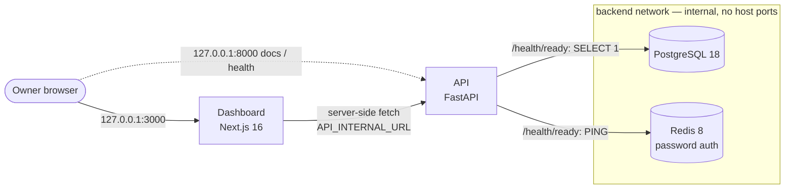

# Architecture Overview

Target architecture is defined in [`docs/spec/02_SYSTEM_ARCHITECTURE.md`](../spec/02_SYSTEM_ARCHITECTURE.md).
This page shows what exists **now** (Phase 00) and what later phases add.

## Phase 00 — implemented

| Component | Responsibility now |
|---|---|
| Dashboard | System status page (live API readiness), `/health` liveness, security headers. No secrets reach the browser; the API call happens on the server. |
| API | Validated settings (fail-fast in production), structured JSON logs with request IDs and redaction, `/health/live`, `/health/ready`. |
| PostgreSQL | Running and health-checked. No schema yet (Phase 01). |
| Redis | Running with password auth and AOF persistence. No queues yet (Phase 03+). |

### Networks
- `backend` is `internal: true`: PostgreSQL and Redis have no route to the internet and no published ports.
- `frontend` carries API ↔ dashboard traffic and the two loopback-only published ports.

## Request flow

1. A request enters the API through `RequestContextMiddleware`, which accepts a safe caller
   `X-Request-ID` (8–128 chars of `[A-Za-z0-9._-]`) or generates one, binds it to the log
   context, and echoes it in the response.
2. Every log line is JSON with UTC timestamp, level, `request_id` and a redaction pass that
   masks sensitive keys (password, token, key, email, phone, address…) and value patterns
   (URL credentials, bearer tokens, provider key shapes, email addresses).
3. Access logs record method, path (no query string), status and duration.

## Added by later phases

Auth + schema (01) → source adapters (02) → discovery workers and Celery queues (03) →
isolated audit browser (04) → AI briefs (05) → design/render sandbox (06) → validation (07) →
proposals and preview gateway (08) → compliant email (09) → full console (10) → Caddy, TLS,
backups, monitoring on the VPS (11).
