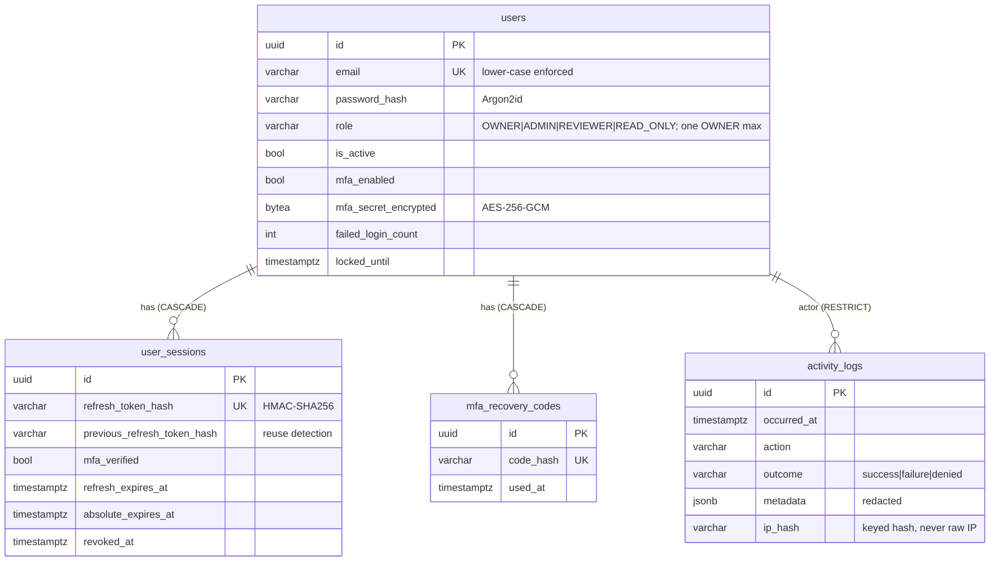
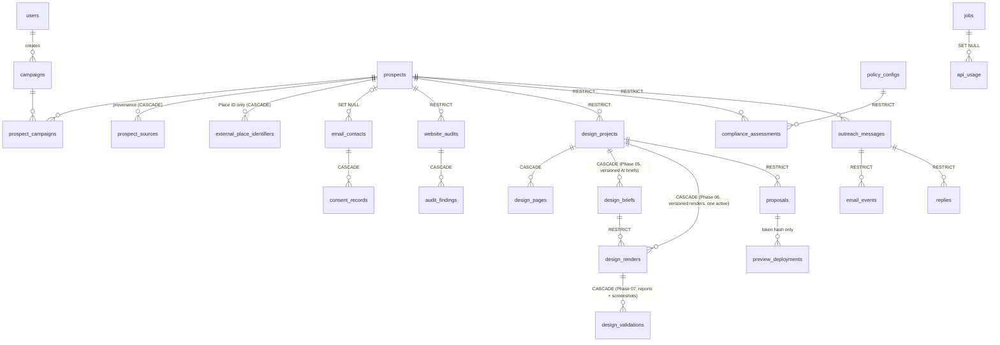

# Database Schema (migrations 0001–0003)

PostgreSQL 18. UUID primary keys (`gen_random_uuid()`), `timestamptz` columns stored in UTC (naive
datetimes are rejected by the ORM), enums stored as `VARCHAR` + `CHECK` (easy to migrate),
explicit foreign-key delete rules. Source of truth: `apps/api/src/webforge_api/models/` and
`apps/api/src/webforge_api/migrations/versions/0001_initial_schema.py`. A test fails if the two differ.

## Identity and audit (used in Phase 01)

`activity_logs` is append-only: database triggers block `UPDATE`, `DELETE` and `TRUNCATE` for every role.

## Business domain (tables staged now, used from Phase 02 onward)

`suppressions` has **no foreign key** to contacts or prospects: it is keyed by a normalised, keyed email
hash so it survives deletion of the personal data it protects. `assets` is standalone (linked by storage key).

## Key constraints

| Rule | Enforcement |
|---|---|
| One OWNER account | partial unique index `uq_users_single_owner` |
| Normalised login email | `CHECK (email = lower(email))` |
| Unique suppression per scope | `UNIQUE (email_hash, scope, scope_ref)` + scope/ref consistency check |
| Unique provider event | `UNIQUE (provider, provider_event_id)` on `email_events` |
| Idempotent jobs and sends | `UNIQUE (idempotency_key)` on `jobs` and `outreach_messages` |
| Policy needs legal review to be ACTIVE | `CHECK` requiring reviewer, qualification, review date, effective date, sources; one ACTIVE per country/recipient/category |
| ISO country codes | `CHECK (country_code ~ '^[A-Z]{2}$')` |
| Prospect history is never silently lost | `RESTRICT` from audits, designs, proposals, assessments, messages, replies |
| Domains are not globally unique | index only on `prospects.verified_domain` (branches may share a site) |

## Indexes for expected queries

Queue scans `jobs(queue, status, available_at)`, `jobs(status, created_at)`; dashboard
`prospects(state, created_at)`, `prospects(country_code, state)`, `campaigns(status, created_at)`;
dedupe `prospects(verified_domain)`; `activity_logs(occurred_at)` and `(entity_type, entity_id)`.

## Phase 02 additions (migration 0002)

| Table / change | Purpose |
|---|---|
| `source_registrations` | Source terms/permission registry: type, status, persistable fields, cache rules, attribution, policy URLs, terms review (URL, version, reviewer, time), status history. CHECK: non-mock sources cannot be ENABLED without a review. Seeded: `google_places`, `official_website`, `mock_places` (all DISABLED) |
| `domain_verifications` | Evidence for website ownership checks: candidate URL and its origin, final URL, domain, status (VERIFIED/HOLD/REJECTED), reason codes, confidence, evidence JSON |
| `transient_source_values` | Encrypted, expiring cache for third-party values permitted by `cache_rules` |
| `external_place_identifiers` | `prospect_id` now nullable (candidates), plus `campaign_id`, `status` (ACTIVE/OBSOLETE), `first_seen_at` |
| `prospect_sources` | `source_type` restricted to independent sources (CHECK), plus `source_key` (FK to registry), `confidence`, `verification_method` |
| `api_usage` | `sku`, `outcome` (RESERVED/SUCCESS/ERROR), `cost_milliminor` |

## Phase 03 additions (migration 0003)

| Table / change | Purpose |
|---|---|
| `system_controls` | Durable pause switches (`global_pause`, `email_pause`), seeded paused, with reason/actor/time |
| `qualification_results` | Every scoring run: rubric version, outcome, score, evidence coverage, per-component evidence, reason codes |
| `prospect_merges` | Manual merge history with a snapshot of the merged prospect |
| `prospects` | `branch_key` (location path on a shared site; index with domain), `do_not_contact`, new state `MERGED` |
| `jobs` | `result` JSON and `created_by_user_id` |
| `source_registrations` | `official_website` may now supply `industry` (from schema.org type) |
