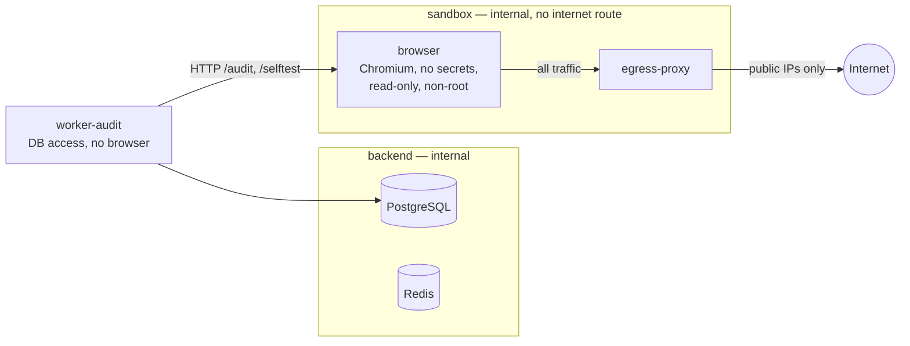

# Browser Sandbox Isolation (Phase 04)

Website audits (and later concept screenshots and PDFs) run in the `browser` service, never in the API or workers.

| Control | How |
|---|---|
| No secrets | `browser` has no `env_file`; only `EGRESS_PROXY_URL` and `HOME`. Self-test checks env names for secret-like keys |
| No DB/Redis/API access | `browser` is only on the `sandbox` network (`internal: true`); it cannot resolve or reach `postgres`, `redis`, `api` |
| No direct internet | `sandbox` network has no external route; every request must go through `egress-proxy` |
| SSRF at the egress | Proxy resolves DNS itself, refuses any non-public answer (loopback, private, link-local/metadata, CGNAT, IPv6 local, mapped forms), connects to the vetted IP, ports 80/443 only, byte/time caps |
| No proxy bypass | Chromium `--proxy-bypass-list=<-loopback>`; WebRTC limited to proxied UDP; QUIC off |
| Untrusted content | No clicks, typing or form submission; downloads cancelled; service workers blocked; non-http(s), media, websocket requests aborted; per-page request cap |
| Disposable | Fresh Chromium per audit, closed afterwards; `/tmp` is tmpfs; root filesystem read-only |
| Resource limits | 1.5 CPU, 1.5 GB memory, 512 pids, page/total time limits, max pages/depth |
| Runtime proof | Before each audit batch the worker calls `/selftest`: direct TCP to db/redis/api/metadata/internet must fail and the proxy must return 403 for internal targets. If not, the job fails with `isolation_unproven` and nothing is crawled |
| Operator proof | `infrastructure/scripts/isolation-check.sh` runs the same checks from inside the running container (also run in CI) |

Known limits: the API process still performs the single-page official-website verification (Phase 02) with the
application-level SSRF fetcher; moving it into the sandbox is planned for Phase 11 hardening.

## Concept validation (Phase 07)

`POST /validate` never browses: the six pages arrive in the request body and are served to a fresh Chromium from
memory at `https://concept.invalid/`. All other requests are aborted and reported, DNS resolution is disabled and
the proxy setting points at a closed port. The same isolation self-test gates validation jobs.
